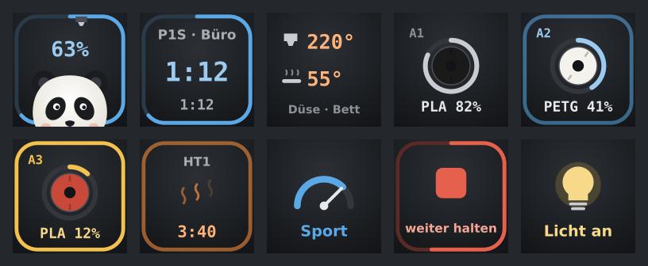
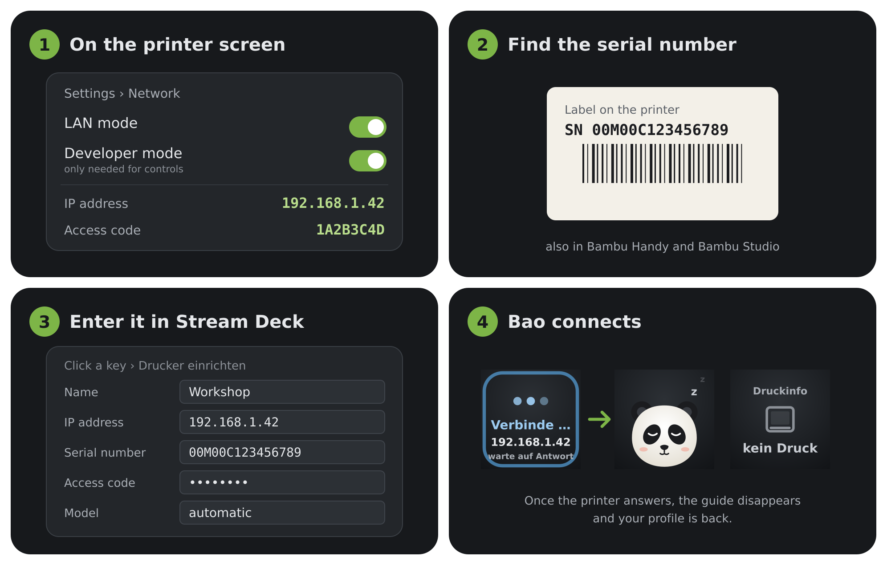
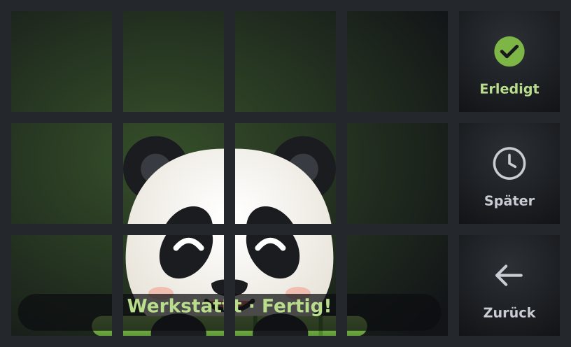

# Bambu Deck

**Watch less. Print more.** A Stream Deck plugin for Bambu Lab printers. Bao the panda watches your prints: progress, AMS spools, temperatures. When a print is done or needs you, Bao takes over the whole deck.

Runs on your LAN over MQTT. No account, no cloud, no telemetry.

**[bambu-deck.com](https://bambu-deck.com)** · [Download the latest release](https://github.com/web-workers-com/bambu-deck/releases/latest) · [Report a printer or a bug](https://github.com/web-workers-com/bambu-deck/issues)



> Unofficial community project, not affiliated with Bambu Lab. Bambu Lab, X1, P1, P2, A1, H2 and AMS are trademarks of their owners.

## Install

Download `bambu-deck-<version>.streamDeckPlugin` from the [latest release](../../releases/latest) and double-click it. Stream Deck installs the plugin with a ready-made profile for every Stream Deck model, plus the alarm profiles.

Then click the **Bao (Drucker)** key and enter your printer's IP address, serial number and access code (on the printer: Settings › Network, on P1 and A1: Settings › WLAN). Up to four printers. Until a printer answers, Bao explains the setup across the whole deck, step by step for your printer model. No printer at hand? Switch on the demo printers in the same place.

The UI is in German for now.

## Connect your printer



1. On the printer screen: **Settings › Network** (P1 and A1: **Settings › WLAN**), turn on **LAN mode**. For controls (pause, light, preheat) also turn on **developer mode**. IP address and access code are on the same page.
2. The serial number is on the label on the printer, and in Bambu Handy and Bambu Studio.
3. Click a Bambu Deck key in Stream Deck and fill in "Drucker einrichten": name, IP address, serial number, access code. For X2D, A2L, H2C, H2D Pro and H3C pick the model by hand.
4. Bambu Deck connects on your LAN. If nothing comes back, the key says why: timeout, access code or serial number.

## Keys

| Key | What it does |
| --- | --- |
| Bao | The printer's state as a panda: asleep, heating, printing, paused, done, error, offline. Progress runs around the edge; press to switch percent / time left / layer. "Compact" look for several printers side by side |
| AMS spool | One slot (A1 … D4, HT1/HT2, external, or "the one printing"): colour, material, what's left. Spools without RFID show a question mark |
| AMS humidity | Percent (AMS 2 Pro, AMS HT) or level (AMS), and drying time left |
| Temperatures | Nozzle and bed, or nozzle, bed, chamber on their own |
| Pause / resume, light, speed | What it says |
| Stop | Only after holding the key for two seconds |
| Dial (Stream Deck +) | Nozzle, bed, fan or speed |
| Test alarm | A sample "done" or "error" alarm |
| Controls | Puts every control across the whole deck: pause, stop (hold), light, speed, preheat, fans, axes, load/unload filament. Whatever the printer lacks is left out; small decks page through, "Fertig" goes back |
| Preheat | PLA, PETG, ABS/ASA, TPU or cool down; shows the heat-up, press again to switch off. Only while not printing |
| Fan | Part, auxiliary or chamber fan: off → 50 % → 100 % |
| Job info | Done at (clock time), time left, layer or file name; press to switch |
| Axes | Home (G28), Z +10 mm, Z −10 mm. Only while not printing |
| Filament | Load a spool from the AMS (its colour on the key) or unload. Only while not printing |
| G-code | Your own macro with its own name, optionally also while printing |
| Camera | Press to put the live picture across the whole deck, every key showing its part; press again to go back (stops by itself after 5 minutes). X1, H2, P2S need LAN liveview on the printer and ffmpeg on the computer (`winget install ffmpeg`); P1 and A1 send JPEGs directly |

## Alarm



Print done, print failed (not when you cancelled it yourself), paused with an error such as filament runout, or a new serious HMS message: the deck switches to the alarm profile. The right-hand keys answer (Done, Later, Resume, Cancel by holding); every picture key leads back.

## Printers

| Series | Models | AMS | Status |
| --- | --- | --- | --- |
| X1 | X1 Carbon, X1E | AMS, up to 4 | tested (X1C + AMS) |
| X2 | X2D | AMS 2 Pro, AMS HT | beta |
| P1 | P1S, P1P | AMS, up to 4 | beta |
| P2 | P2S | AMS 2 Pro, AMS HT | beta |
| A1 | A1, A1 mini | AMS lite | beta |
| A2 | A2L | AMS lite | beta |
| H2 | H2D, H2D Pro, H2S, H2C | AMS 2 Pro, AMS HT | beta |
| H3 | H3C | AMS 3H | beta |

X2D, A2L, H2C, H2D Pro and H3C are newer than any serial-number list the plugin knows: pick the model by hand in the settings.

Beta means: built from community knowledge and checked against simulated printers, not yet on real hardware. Have one of these? Run

```bash
npm install
npm run probe -- <ip> <serial> <access code>
```

It connects for 20 seconds, only asks for the full status, prints what Bambu Deck understands and saves the raw report (serial removed) to `tests/fixtures/`. Open an issue with that file and your model.

**Control and firmware:** Showing status always works. Newer Bambu firmware only lets third-party apps control the printer (pause, light, speed) in LAN mode with developer mode enabled. If the printer refuses, the key flashes and the log says why.

## Develop

```bash
npm install
npm run build        # settings pages, icons, profiles, plugin
npm run link         # link into Stream Deck (also from WSL), restarts it
npm test
npm run preview      # contact sheet of all keys → .build/preview.png
npm run pack         # dist/com.bambudeck.plugin.streamDeckPlugin
```

- `src/mqtt/` a small dependency-free MQTT 3.1.1 client over TLS
- `src/bambu/` report → status, commands, models, LAN connection, demo printers
- `src/alerts.ts` when Bao calls; `src/roles.ts` what each alarm key does
- `src/render/` every key image as SVG
- `src/actions/` the Stream Deck actions

## License

MIT
